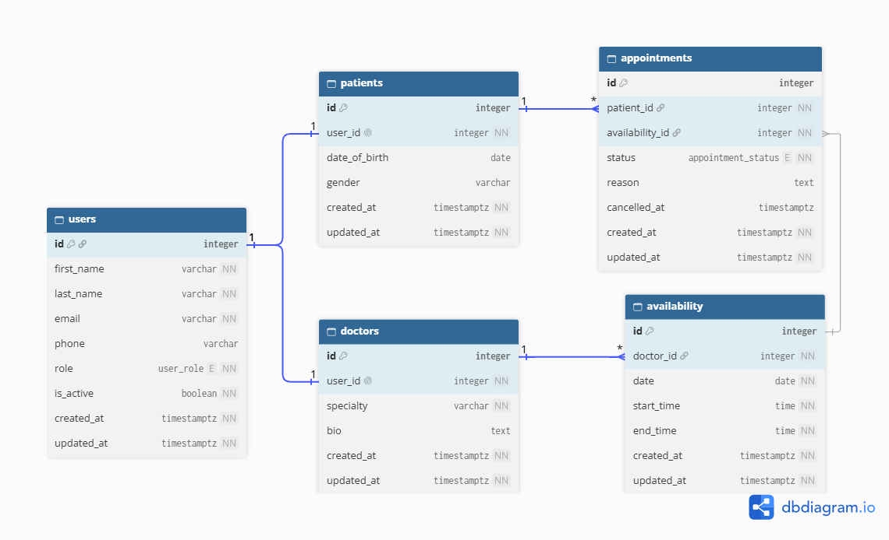

# Schedule Project

The project has an independently run Next.js frontend and Express.js API. Both use npm and can be started from the repository root or their own folders.

## Requirements

- Node.js LTS and npm

## Install

```bash
cd frontend
npm install
cd ../backend
npm install
```

## Run in development

Start each process in a separate terminal, from the repository root:

```bash
npm run dev:frontend
npm run dev:backend
```

Or run `npm run dev` inside `frontend` and `npm run dev` inside `backend`. The frontend is available at [http://localhost:3000](http://localhost:3000); the API health endpoint is [http://localhost:3001/health](http://localhost:3001/health).

The API defaults to port `3001` and allows browser requests from `http://localhost:3000`. Copy `backend/.env.example` to `backend/.env` to customize `PORT` or `FRONTEND_ORIGIN`. Copy `frontend/.env.example` to `frontend/.env.local` to configure `NEXT_PUBLIC_API_URL` for frontend code that calls the API.

## Production start

Build the frontend with `npm --prefix frontend run build`, then start it with `npm run start:frontend`. Start the API with `npm run start:backend`. Configure `NEXT_PUBLIC_API_URL` at frontend build time and `PORT`/`FRONTEND_ORIGIN` in the backend environment as needed.

## ER Diagram


